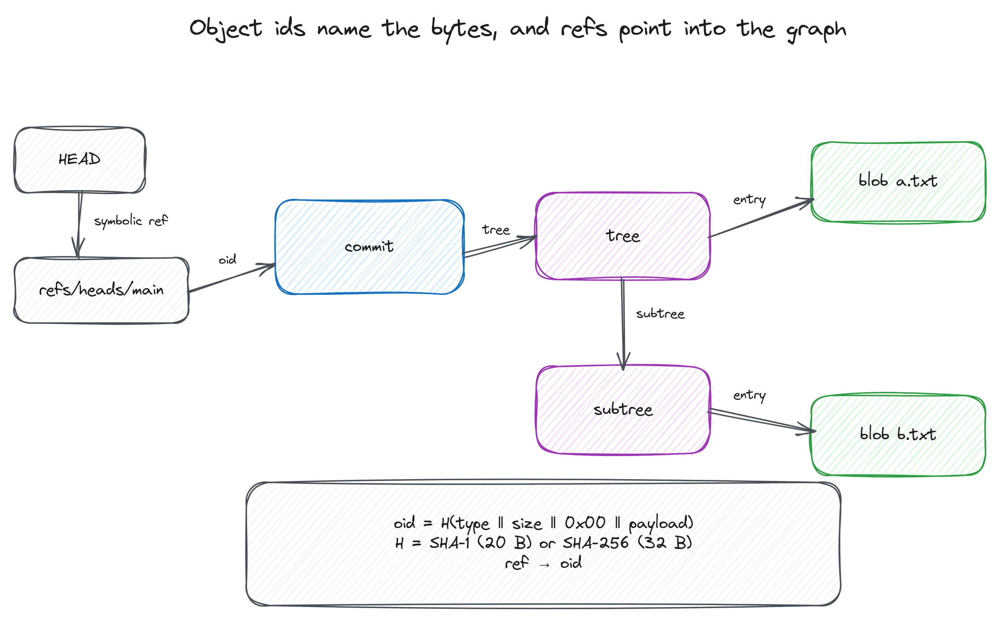
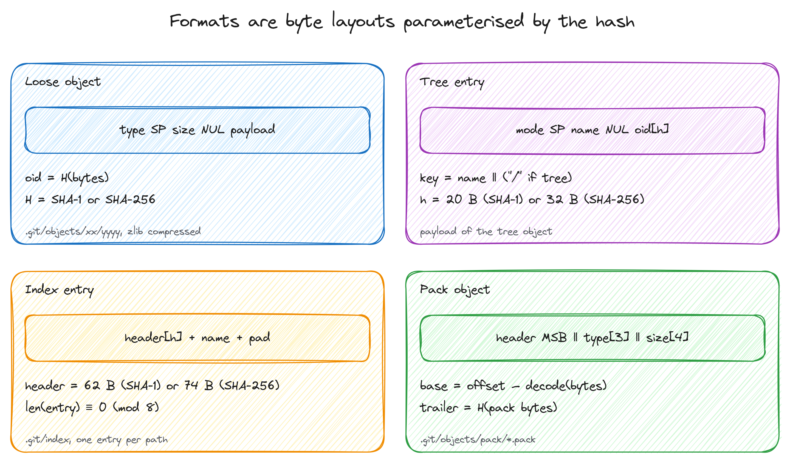
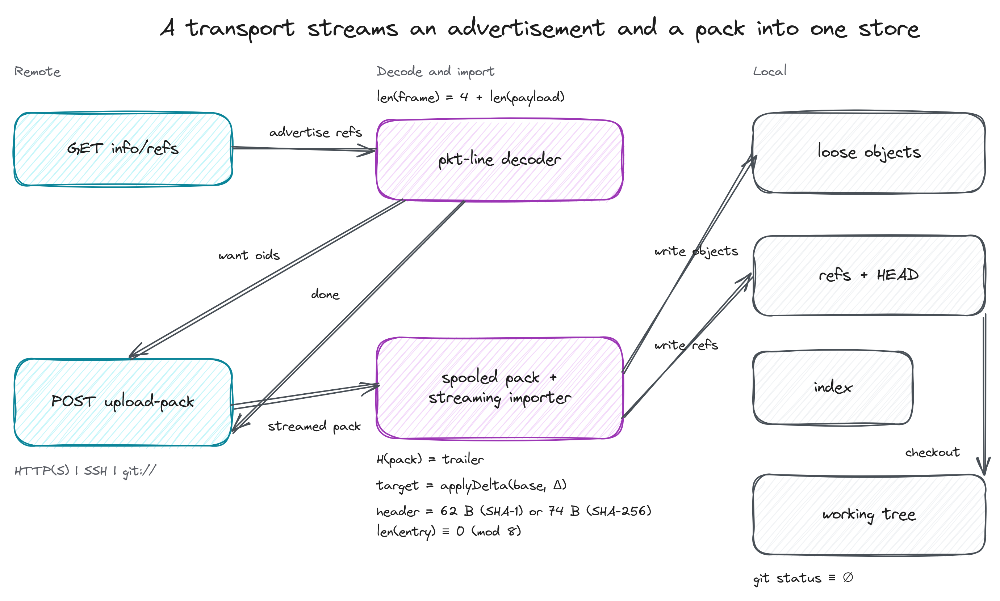
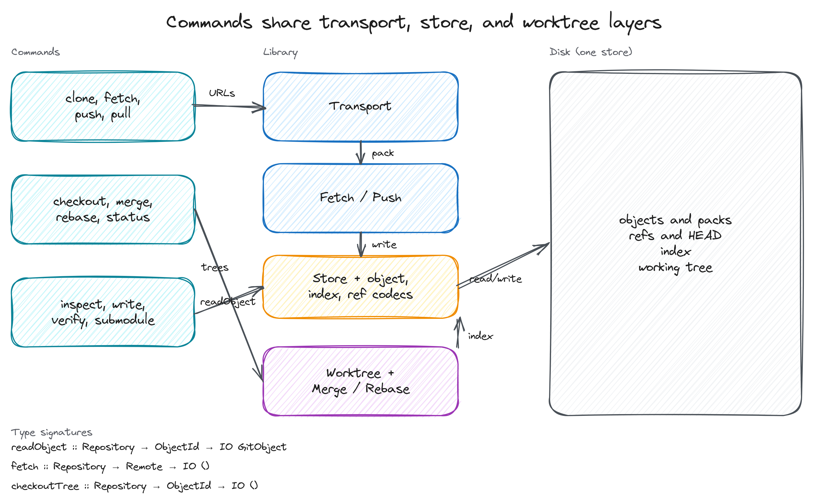

# haskell-git

haskell-git clones, fetches, pushes, and works with Git repositories over
Smart HTTP, SSH, and git://, then reads, writes, and checks them. It implements
the formats itself, so it does not need a C Git library and does not call `git`
for repository work. Use it to inspect a repository from code you can read, or
to check that an object store is intact.

The first command:

```console
$ haskell-git clone https://github.com/githubtraining/hellogitworld hello
Cloning into 'hello'...
HEAD is ef7bebf8bdb1919d947afe46ab4b2fb4278039b3 on master
```

Then `cd hello` and `git status --porcelain` prints nothing. The clone wrote the
index as well as the working tree, so git sees a clean checkout.

## Build it

The development environment is a devenv shell. It provides GHC, cabal, git,
python3, and the C libraries the zlib binding needs.

```console
$ devenv shell
haskell-git dev shell
ghc   9.10.3
cabal 3.16.1.0

build      cabal build
unit-test  cabal test
check      cabal check and cabal test
$ cabal build
```

Install the executable somewhere on your path:

```console
$ cabal install exe:haskell-git --overwrite-policy=always --installdir="$HOME/.local/bin"
```

Without Nix you need GHC 9.6 or newer, cabal-install, and the zlib development
headers. `cabal build` then behaves the same way.

## Clone

```console
$ haskell-git clone https://github.com/githubtraining/hellogitworld hello
Cloning into 'hello'...
HEAD is ef7bebf8bdb1919d947afe46ab4b2fb4278039b3 on master
$ cd hello
$ git branch -a | head -5
* master
  remotes/origin/HEAD -> origin/master
  remotes/origin/bisect
  remotes/origin/fbaddfiles
  remotes/origin/fbmaster
$ git tag
RELEASE_1.0
RELEASE_1.1
$ git fsck --strict
```

Clone fetches every advertised branch and tag, gives the default branch a local
ref, mirrors the other branches under `refs/remotes/origin/`, sets
`refs/remotes/origin/HEAD`, and writes the remote and branch sections of the
config. The checkout restores regular files, executable files, symlinks, and
empty directories for submodule entries, then writes the index from the same
tree.

An empty remote clones too. The result is an empty repository with the remote
config and the advertised default branch, which is what `git clone` leaves
behind.

SHA-1 and SHA-256 repositories are supported. A server that advertises any
other object format is refused by name. A remote URL may be HTTP(S), SSH
(`ssh://` or the scp-like `user@host:path` form), or git://. HTTP Basic and
Bearer authentication work through URL credentials, `GIT_ASKPASS`, or a
credential helper; SSH authentication is delegated to OpenSSH.

## Inspect

Read commands take a revision: `HEAD`, a branch or tag name, a full ref, or a
full object id (40 hex digits for SHA-1, 64 for SHA-256).

```console
$ haskell-git ls-tree -r HEAD | head -4
100644 blob 412eeda78dc9de1186c2e0e1526764af82ab3431	.gitattributes
100644 blob 7c820833a9ad5fbfc96efd533d55f5edc65dc977	.gitignore
100644 blob 17eccd68b7cafa718d53c8b4db666194646e2bd9	.travis.yml
100644 blob adfd6da3c0a3fb038393144becbf37f14f780087	README.txt
$ haskell-git cat-file -p HEAD | head -6
tree f724b12649f1f531c66c1caa65fa3215accfaeb7
parent ebbbf773431ba07510251bb03f9525c7bab2b13a
author Jordan McCullough <jordan@github.com> 1415384839 -0700
committer Jordan McCullough <jordan@github.com> 1415384839 -0700

Fix groupId after package refactor
$ haskell-git log -n 1
commit ef7bebf8bdb1919d947afe46ab4b2fb4278039b3
Author: Jordan McCullough <jordan@github.com>
Date:   Fri Nov  7 11:27:19 2014 -0700

    Fix groupId after package refactor

$ haskell-git rev-parse HEAD
ef7bebf8bdb1919d947afe46ab4b2fb4278039b3
```

`cat-file` prints the stored payload for commits and tags, so a signed commit
keeps its signature. `-t` prints the type and `-s` prints the payload length.

Objects are read from loose files or from pack files. The pack index, the pack
object header, and both delta encodings are parsed here, so a repository that
`git gc` packed is as readable as one with loose objects.

## Verify

```console
$ haskell-git verify
verify: 306 objects, 13 refs, 0 problems
```

`verify` decompresses and decodes every loose object, rehashes it, checks the
pack trailer checksum, resolves every packed object and compares it with its id,
and checks that every ref and HEAD point at an object that exists. Each problem
prints on its own line. The exit status is 0 for a clean repository, 1 when
problems were found, and 2 for a usage error.

The index and working tree are derived state, so `verify` does not check them.
`git status` is the tool for that.

## Write a commit

The plumbing commands compose the same way git's do.

```console
$ haskell-git init
Initialized empty Git repository in /tmp/write-demo/.git/
$ git config user.name "Ada"
$ git config user.email "ada@example.com"
$ printf 'hello\n' > hello.txt
$ mkdir docs && printf 'notes\n' > docs/notes.txt
$ haskell-git add .
$ TREE=$(haskell-git write-tree)
$ echo "$TREE"
5b083868b1b325fb1e029e3934baeec6787998e6
$ COMMIT=$(haskell-git commit-tree "$TREE" -m "First commit")
$ haskell-git update-ref refs/heads/main "$COMMIT"
$ git log --format=%s
First commit
$ git status --porcelain
$ git fsck --strict
```

`init` creates a SHA-1 repository by default. Pass
`--object-format=sha256` to create a SHA-256 repository; a clone always adopts
the remote's format.

The tree id depends only on the file contents, so that value is reproducible.
A commit id also covers the author and committer timestamps, so it changes from
run to run.

`commit-tree` reads the author and committer from `GIT_AUTHOR_*` and
`GIT_COMMITTER_*` when set, and from the repository `user.name` and `user.email`
otherwise. It prints the new commit id and leaves HEAD alone, like git.

## Fetch, push, and pull

```console
$ haskell-git fetch origin
$ haskell-git push origin main:main
$ haskell-git pull origin
```

`fetch` writes `FETCH_HEAD` and the remote-tracking refs, and `push` sends the
objects reachable from the new tips that the remote does not already have.
Push requires a fast-forward unless `--force` is used, and `--delete` removes
a ref. `pull` is fetch followed by a merge; `pull --rebase` replays the local
commits on top of the fetched head instead.

## Branches and history

```console
$ haskell-git checkout -b feature
$ haskell-git switch main
$ haskell-git merge feature
$ haskell-git rebase main
$ haskell-git status
$ haskell-git reset --hard HEAD~1
```

`merge` fast-forwards when possible, otherwise performs a three-way merge of
the trees. Conflicts are written with index stages 1-3 and conflict markers;
resolve them and run `merge --continue`, or use `merge --abort`. `rebase`
replays the current branch's commits, preserving author identity and stopping
on a conflict so that `rebase --continue`, `--skip`, or `--abort` can be used.
A `checkout` refuses to overwrite local changes.

## How it works

Git stores four kinds of object. A blob holds file bytes, a tree holds names and
object ids, a commit points at a tree and its parents, and a tag points at
another object. An object id is the SHA-1 or SHA-256 hash of the object header
and payload, so the name of an object is derived from its bytes.



A reference is a file that contains an object id, or a symbolic reference to
another reference. `HEAD` points at a branch in a normal checkout and directly
at a commit in a detached one. Tags and branches live under `refs/`.

The four files the tool reads and writes have hash-parameterised layouts. The
figure below shows the loose object, the tree entry, the index entry, and the
pack object header. The formulas are the rules this implementation follows:
the loose object id is the repository hash of the encoded object, a tree sorts
directories as their name plus a slash, an index entry header is 62 bytes for
SHA-1 and 74 bytes for SHA-256 and is padded to an eight-byte boundary, and an
offset delta base is found by subtracting the decoded distance from the
entry's own offset.



The clone pipeline turns an advertisement and a pack stream into a repository
over HTTP(S), SSH, or git://. A pkt-line frame is four hex digits of length and
the payload, `want` lines name the object ids the client needs, and the server
answers with a streamed pack. The pack is spooled to a temporary file,
checksummed, and imported incrementally; resolved objects become loose objects,
then refs, the index, and the working tree.



Network commands share one transport layer, and local commands share one store.
`clone`, `fetch`, and `push` speak through `Transport`; `cat-file`, `ls-tree`,
`log`, and `verify` read through `Store`; checkout, merge, and rebase update
the worktree and index from the same store. Pack indexes are loaded once per
command and packed objects are read through file handles on demand.



The index is written in version 2. Each entry has a fixed header whose size
follows the object format, the path, and padding to the next eight-byte
boundary, and the file ends with the repository hash. The stat fields are left
as zero: git treats a zero size as "hash the file and compare", so a fresh
checkout is clean and git fills the stat fields in on the next status.

Pack files are read through file handles and streamed into the importer; a
clone or fetch spools the response to a temporary pack file and never keeps
the whole pack in memory. Resolved delta bases are cached in a bounded memo
table. A single object must still fit in memory while it is read or checked
out, and pack index tables are loaded in full.

## Limits

- Smart HTTP, SSH, and git:// are supported. SSH is implemented by invoking
  OpenSSH, as git itself does; there is no in-process SSH stack. HTTP
  Digest/NTLM authentication is not supported.
- SHA-1 and SHA-256 are supported. Object formats cannot be converted, and a
  dual-hash `compatObjectFormat` repository is refused.
- Pack files are streamed, but a single object is held in memory while it is
  read. Pack index tables are loaded in full.
- Submodules are initialised with `clone --recurse-submodules` and
  `submodule update --init [--recursive]`; `submodule add`, `deinit`,
  `foreach`, and `absorbgitdirs` are not implemented. A normal clone still
  leaves empty submodule directories, matching git.
- `fetch`, `push`, `pull`, `merge`, `rebase`, `checkout`, `switch`, `branch`,
  `status`, and `reset --hard` are implemented. Interactive rebase, octopus
  merges, rename-aware merges, reflogs, hooks, signed-commit verification,
  shallow/partial clone, LFS, and Windows remain out of scope. Convenience
  flags such as `merge --no-ff`, `rebase --onto`, and `push --set-upstream` are
  also not implemented.
- Merge resolves changes at file granularity. If both sides modify the same
  file, it reports a conflict rather than attempting a line-level diff3. It
  does not detect renames.
- Fetch asks for the needed tips and receives a full pack; it does not yet send
  `have` lines for a compact negotiation.
- Push works over Smart HTTP and SSH. `git://` receive-pack is not enabled
  (the git daemon normally disables it).
- `status` does not evaluate `.gitignore`; untracked files are reported without
  ignore filtering. `submodule sync` is not implemented.

## Tests

```console
$ cabal test
```

The suite uses git as the reference. Integration tests start real
`git http-backend` servers (including an authenticated one) and a real
`git daemon`, exercise a fake `GIT_SSH_COMMAND`, and check results with
`git status`, `git fsck --strict`, `git ls-tree`, and `git submodule status`.
Unit tests cover the codecs, the streaming pack reader, delta resolution,
index stages, fetch/push protocols, merge and rebase, and corrupted objects.

`devenv shell -- unit-test` runs the same suite from the shell, and
`devenv shell -- check` adds `cabal check`. `scripts/memory-benchmark.sh`
builds a large packed repository and checks the peak memory of `clone` and
`verify`.
