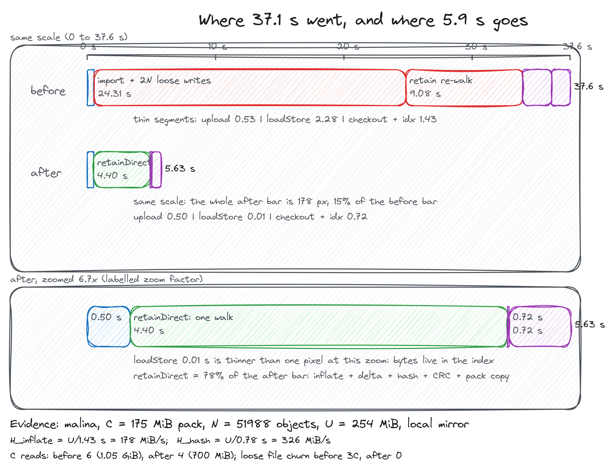
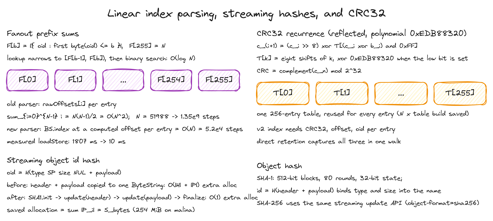
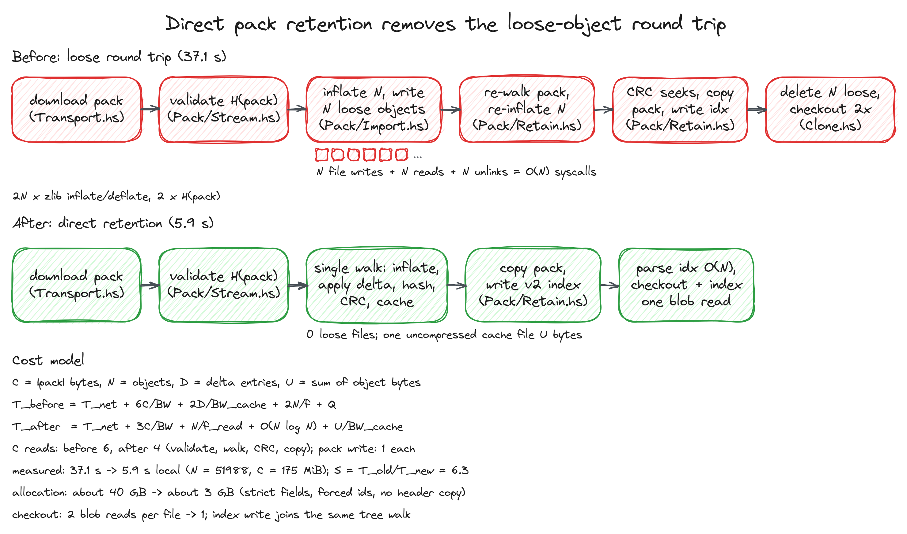
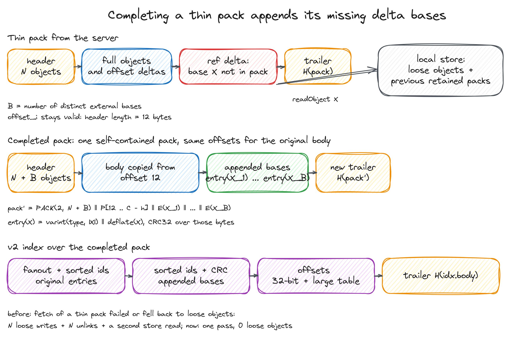
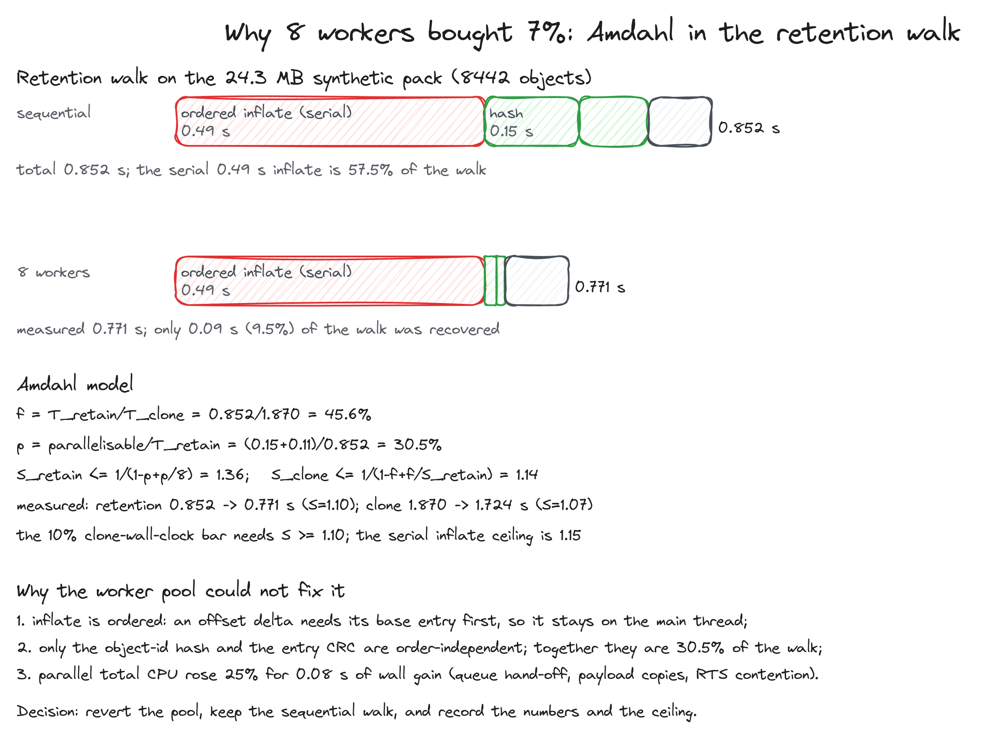

# Reflections: two optimization passes on the clone path

This document is a worklog for two rounds of performance work on
`haskell-git`, a Git implementation written in Haskell. The first pass rebuilt
clone around a single-pass "direct pack retention" path; the second pass added
thin-pack completion to fetch, measured and rejected a multithreaded
retention experiment, and added phase/timer instrumentation to the CLI. It is
written in the style of a performance worklog: every change is motivated by a
cost model, measured on real and synthetic repositories, and the figures carry
the evidence.

Figures are generated from `docs/figures/gen_figures.py` with the Excalidraw
CLI. The drawing rules for this document are in
[`docs/figures/RULES.md`](figures/RULES.md); the same rules, palette, and
checklist are exported declaratively from `~/nixos/agents/excalidraw.nix`.

All numbers in this document were measured on the machine that ran the work:
an AMD Ryzen 7 5700X (8 cores, 16 threads), 62 GiB RAM, Linux, GHC 9.10.3,
`-O1` builds, `git` 2.56 as the interoperability oracle.

## Contents

1. [The workloads and the measurement method](#1-the-workloads-and-the-measurement-method)
2. [The original clone pipeline and its cost model](#2-the-original-clone-pipeline-and-its-cost-model)
3. [The mathematics of the pack format](#3-the-mathematics-of-the-pack-format)
4. [Pass 1: direct pack retention](#4-pass-1-direct-pack-retention)
5. [Pass 1 results](#5-pass-1-results)
6. [Pass 2: thin-pack fetch completion](#6-pass-2-thin-pack-fetch-completion)
7. [Pass 2: the multithreading experiment that was rejected](#7-pass-2-the-multithreading-experiment-that-was-rejected)
8. [Pass 2: measuring the clone with progress and timers](#8-pass-2-measuring-the-clone-with-progress-and-timers)
9. [Haskell engineering notes](#9-haskell-engineering-notes)
10. [Limits and remaining headroom](#10-limits-and-remaining-headroom)
11. [Reproducing the measurements](#11-reproducing-the-measurements)
12. [Appendix A: symbol table and derivations](#appendix-a-symbol-table-and-derivations)

## 1. The workloads and the measurement method

Two private repositories from the same GitHub account were used as the
"large repository" fixtures, plus a generated repository for the parallel
experiment and for the thin-pack tests.

| workload | pack size \(C\) | objects \(N\) | commits | notes |
| --- | ---: | ---: | ---: | --- |
| `antagony` | 43.15 MiB | 28,023 | 1,464 | real GitHub repo |
| `malina` | 175.24 MiB | 51,988 | 2,529 | real GitHub repo, largest fixture |
| synthetic | 24.3 MiB | 8,442 | 201 | 4,000 files, 40 directories, generated |

Three measurement setups are used throughout, and they answer different
questions:

1. **Real network.** `haskell-git clone git@github.com:meillaya/<repo>.git`
   over SSH with the user's key. This is the number a user sees.
2. **Local bare mirror.** The SSH remote is replaced by a fake
   `GIT_SSH_COMMAND` that executes `git-upload-pack <local-bare-repo>`. The
   network disappears and the number is almost pure client-side
   CPU/IO work. This is the number that attributes cost to code.
3. **Retention-only.** A standalone harness feeds a pre-generated pack file
   directly to `retainPackDirectly`. This isolates the pack-processing kernel
   from network and checkout.

All wall-clock numbers are `date +%s%N` deltas around the process, with clones
into fresh temporary directories and page caches warm from a preceding run.
RTS statistics (`+RTS -s`) are used for allocation and GC numbers.
Instrumented builds used temporary `HASKELL_GIT_TIMING`-gated timers around
`transportDiscovery`, upload, `retainPackDirectly`, `importPackFile`,
`loadStore`, checkout, and index writing; those timers were removed before the
release commit.

For the network floor, `git clone --bare` of the same repositories over the
same SSH connection measured 3.58 s for `antagony` (43.15 MiB) and 9.46 s for
`malina` (175.24 MiB). Those are the lower bounds for any clone of those
repositories on this connection; a client can add work on top of them but
cannot remove the transfer.

## 2. The original clone pipeline and its cost model

A clone receives one streamed pack. After discovery, the client spools the
pack, verifies its trailer, and then has to turn the pack into a repository:
a pack file, a pack index, refs, an index, and a working tree.

Let

- \(C\) be the compressed pack size in bytes,
- \(U\) be the sum of the uncompressed object payloads,
- \(N\) the object count, \(D\) the number of delta entries,
- \(B\) the number of distinct external bases (thin packs),
- \(f\) the achievable small-file syscall rate, \(BW\) the relevant bandwidth,
- \(h\) a hash throughput, \(\iota\) an inflate throughput, \(\zeta\) a
  deflate throughput, \(\gamma\) a CRC throughput.

Then the original clone wall time was, to first order,

$$
T_{\text{old}} =
T_{\text{net}}+\frac{C}{BW_{\text{disk}}}
+\underbrace{\frac{C}{h_{\text{pack}}}}_{\text{validate pack}}
+\underbrace{\frac{C}{BW_{\text{read}}}+\frac{U}{\iota}}_{\text{import walk}}
+\underbrace{\frac{U}{\zeta}+\frac{U}{BW_{\text{write}}}+\frac{2N}{f}}_{\text{loose writes/reads/deletes}}
+\underbrace{\frac{C}{h_{\text{pack}}}+\frac{C}{BW_{\text{read}}}+\frac{U}{\iota}}_{\text{retain walk again}}
+\underbrace{\frac{C}{\gamma}+\frac{C}{BW_{\text{read}}}+\frac{C}{BW_{\text{write}}}}_{\text{CRC + pack copy}}
+T_{\text{tree}}+T_{\text{index}}+Q .
$$

The important part is not the exact coefficients, it is the shape:
\(T_{\text{old}}\) contains **six full reads of the pack** (two validation
hashes, two inflate walks, a CRC re-read, and the copy read), **\(2N\)
filesystem operations** (a loose write and a delete per object, plus reads for
delta bases), and **two full inflate passes over \(U\)** plus a deflate pass
to create the loose objects. The two inflate passes are pure duplication: the
import walk already resolved every delta to compute the object id, and the
retain walk redoes that work to build the index.

That model matched the measurement. The phase table for `malina` from the
instrumented build was:

| phase | before (ms) | after (ms) |
| --- | ---: | ---: |
| discovery | 4 | 4 |
| network upload | 533 | 500 |
| import walk + loose writes | 24,305 | — |
| retain walk + CRC + copy | 9,075 | — |
| retainDirect (single walk) | — | 4,400 |
| `loadStore` (validate + parse idx) | 2,278 | 10 |
| checkout | 745 | 720 (with index write) |
| index write | 689 | — (fused) |
| refs + config | 1 | 1 |
| wall | ~37.1 s | ~5.7 s |



*The same 0-to-37.6 s scale shows how much of the old clone was pack
processing; the 6.7x zoomed bar shows what is left. `import` + `retain`
accounted for 89% of the old wall time. Data from the malina phase table
above.*

The allocation numbers tell the same story from the heap side. The old clone
of `malina` ran 35.3 s MUT with 1.16 GB/s allocation rate, about 40.9 GB
allocated for a 254 MiB uncompressed object set: roughly \(160\times\) the
payload bytes. The new clone runs 4.97 s MUT at 1.86 GB/s, about 9.3 GB, or
\(36\times\). This is not a constant-factor accident; it is the sum of the
copies listed above (encoding every object, hashing it, compressing it,
re-reading it, and encoding it again for the index).

## 3. The mathematics of the pack format

Every optimization below is an argument about the two files the clone writes:
the `.pack` and the `.idx`. This section fixes the notation.

### 3.1 Objects and object ids

A Git object is a type, a payload, and a header that spells the type and the
payload length in decimal:

$$
\text{header}(t, \ell) = \text{ASCII}(t)\,\|\,\text{ASCII}(\ell)\,\|\,\texttt{0x00}
$$

and the object id is

$$
\operatorname{oid}(t, P) = H\big(\text{header}(t, |P|)\,\|\,P\big),
$$

where \(H\) is SHA-1 or SHA-256 and \(|P|\) is the payload length. The type and
size are *inside* the hash, which is why a blob and a commit with the same
payload have different ids. For `malina`, \(\sum_P |P| = U = 254\) MiB, and
every byte of that sum is hashed exactly once in the new pipeline.

### 3.2 Variable-length sizes and entry headers

A pack entry begins with a header that packs a 3-bit type and a
little-endian base-128 size:

$$
\text{byte}_0 = (\text{type}\ll 4)\;|\;(b_0 \mathbin{\&} 0x0f)\;|\;(\text{more}\ll 7),
$$

$$
\text{size} = (b_0 \mathbin{\&} 0x0f)
 + \sum_{i\ge 1} (b_i \mathbin{\&} 0x7f)\cdot 2^{7i-3},
$$

where bit 7 of each byte says "another size byte follows". The type codes are
1 commit, 2 tree, 3 blob, 4 tag, 6 offset delta, 7 reference delta.

For an offset delta, the base is found by decoding a second varint distance
and subtracting it from the entry's own offset:

$$
\text{base offset} = \text{entry offset} - \text{distance}.
$$

For a reference delta, the entry contains the 20- or 32-byte base object id
instead. In both cases the entry payload is a DEFLATE (zlib) stream of the
delta instructions.

### 3.3 Delta instructions

A delta is a varint base size, a varint result size, and a sequence of
instructions. An instruction is either a literal insert or a copy from the
base:

$$
\text{op} = \begin{cases}
\text{copy}, & \text{op} \mathbin{\&} 0x80 \neq 0\\
\text{insert}(n), & \text{op} < 0x80
\end{cases}
$$

For a copy, the low bits of the opcode select which of the four offset bytes
and three size bytes follow; for an insert, the opcode itself is the literal
length. The decoder is

$$
P_{\text{result}}[p \ldots p+n) =
\begin{cases}
P_{\text{base}}[o \ldots o+n), & \text{copy}\\
\Delta[q \ldots q+n), & \text{insert}
\end{cases}
$$

and the result size must equal both the pack header's declared size and the
delta's own result size. Applying a delta is \(O(|P_{\text{result}}|+|P_{\text{base}}|)\),
which is why retaining a resolved base in a cache matters: a chain of depth
\(k\) without a cache costs \(\sum_{i=1}^{k} |P_i|\), and a bounded memo table
turns that into an amortized one pass.

### 3.4 The pack index v2

The pack index has a 256-entry fanout table, the sorted object ids, the CRCs,
the 32-bit offsets, the large-offset table, a pack hash, and an index hash:

$$
\text{fanout}[b] = \#\{\text{oid} : \text{first byte}(\text{oid}) \le b\},
\qquad \text{fanout}[255] = N.
$$

A lookup of an id with first byte \(b\) only has to search the interval
\([\text{fanout}[b-1], \text{fanout}[b])\), where the ids are sorted, so the
cost is \(O(\log N)\). For \(N = 51{,}988\) that is at most 16 comparisons of
20 bytes.

The CRC32 of an entry is a 32-bit reflected CRC over the entry's raw bytes
(header, base reference, and compressed payload), with the reflected
polynomial \(0xEDB88320\) and final complement:

$$
c_{i+1} = (c_i \gg 8) \oplus T\big[(c_i \oplus b_i) \mathbin{\&} 0xFF\big],
\qquad
\text{CRC} = \neg c_n \bmod 2^{32},
$$

where \(T[k]\) is built by eight shifts of \(k\) with the polynomial applied
when the low bit is set. The table is a constant: 256 entries, built once per
process. The pack trailer is \(H(P)\), the hash of every byte of the pack
before the trailer.



*The three per-entry computations that the index needs: the fanout interval,
the streaming object-id hash, and the CRC32 recurrence. The old parser paid
O(N^2) for the first, the old copy-based hash paid an O(|P|) allocation per
object, and the CRC is why the direct path can never avoid touching the
compressed bytes at least once.*

### 3.5 Complexity summary

| operation | old | new | note |
| --- | --- | --- | --- |
| index parse | \(O(N^2)\) list indexing | \(O(N)\) slicing | 1.35e9 -> 5.2e4 steps at N=51,988 |
| object id hash | \(O(|P|)\) copy + hash | \(O(|P|)\) hash only | copy removed, not hashing |
| pack validation | \(O(C)\) twice | once | 0.47 s saved |
| inflate/pass | 2 passes | 1 pass | 1.4 s saved at `malina` scale |
| loose churn | \(2N\)+ file ops | 0 | 52k writes + reads + unlinks saved |
| store open | \(O(C)\) hash + \(O(N^2)\) parse | \(O(N)\) parse | 2.28 s -> 0.01 s |
| checkout | 2 blob reads/file | 1 | one decompression per file saved |

## 4. Pass 1: direct pack retention

### 4.1 What was removed

The old path was a pipeline of five expensive stages:

1. `importPackFile`: validate the pack, then walk the pack sequentially,
   inflate each object, resolve deltas, and write **every** resolved object as
   a loose zlib file. Delta bases are read back from those loose files.
2. `retainPackFile`: validate the pack again, walk it again, inflate every
   object again, re-read bases from the loose files, re-read each entry to
   compute the CRC, build the index, copy the pack, and delete every loose
   file.
3. `loadStore`: parse the index and validate the pack a third time.
4. Checkout: flatten the tree, read every blob once to write it, then flatten
   the tree again and read every blob again to get the size field for the
   index.
5. Object ids: `encodeGitObject` allocated `header <> payload` for every
   object; the loose writer then compressed that copy and the object id
   hashed a second encoding of the same object.

The direct retention path replaces 1-2 with one walk and keeps the
information it already computed:

- every entry's object id, offset, and CRC are recorded as the walk resolves
  it;
- delta bases are kept in an **uncompressed** temporary cache file instead of
  being re-written as zlib-compressed loose files;
- the pack is copied once into `.git/objects/pack/pack-<hash>.pack` and its
  v2 index is built from the recorded metadata, with no second pack walk;
- no loose objects are created at all for a self-contained pack.



*The old pipeline materialized every object as a loose file only to read it
back and delete it. The new pipeline keeps resolved payloads in one temporary
uncompressed cache, records id/offset/CRC during the single inflate walk, and
writes the pack and index directly. The churn row is the O(N) file work that
disappears.*

### 4.2 The uncompressed cache and the memory bound

The design constraint is that a single object may be large and the pack may be
much larger than RAM, so the cache cannot be the whole pack in memory. The
retention state is:

- `offsetMap :: Map Int CachedObject`: pack offset to (cache offset, length,
  type), one entry per object,
- `objectMap :: Map ObjectId CachedObject`: object id to the same entry, used
  by reference deltas,
- `indexEntries :: [RetainedObject]`: (id, pack offset, CRC) per object,
- one append-only cache file on disk holding the resolved payloads.

The peak memory is therefore

$$
M_{\text{retain}} = O(N) + O(\max_\text{object} |P|) + O(1)\ \text{handles},
$$

and the cache file uses \(U\) bytes of disk instead of \(U\) bytes of RAM.
The old path had the same asymptotic memory bound but paid a much larger
constant: every payload was compressed, written, and deleted, and the base
lookup was a filesystem read of a loose file rather than a seek into one
open file.

The cache access pattern is: sequential appends for new payloads, random
reads for delta bases. It is deliberately uncompressed. Compressing the cache
would save disk at the cost of exactly the CPU that the direct path is trying
to avoid; the payloads are written once and read as bases at most once per
referencing delta, so the cache is an I/O device, not a compression problem.

### 4.3 Streaming object ids: removing the header copy

The old code computed an object id by building the full encoded object:

```haskell
objectIdForObjectFor hashAlgorithm = hashBytesFor hashAlgorithm . encodeGitObject
```

`encodeGitObject` is `header <> NUL <> payload`, so the hash consumes a
freshly allocated `|header| + |payload|` byte string per object. Over the
whole pack that is an extra \(U\) bytes of allocation for the payloads alone,
plus one header per object. The replacement hashes the two pieces
incrementally:

```haskell
hashPartsFor :: HashAlgorithm -> ByteString -> ByteString -> ObjectId
hashPartsFor Sha1 first second =
    ObjectId (SHA1.finalize (SHA1.update (SHA1.update SHA1.init first) second))
hashPartsFor Sha256 first second =
    ObjectId (SHA256.finalize (SHA256.update (SHA256.update SHA256.init first) second))
```

This is sound because SHA-1 and SHA-256 are Merkle-Damgard constructions:
processing the concatenation in two `update` calls is identical to processing
the concatenation in one call. Only the small `header <> 0x00` string is
allocated, so the per-object allocation drops from \(O(|P|)\) to \(O(1)\):

$$
A_{\text{before}} - A_{\text{after}} = \sum_{e=1}^{N} |P_e| = U.
$$

For `malina` that is 254 MiB less allocation on the clone path (and the same
saving applies to every `writeLooseObject` on the thin-pack fallback path).

### 4.4 Linear index parsing

The old parser built a list of 32-bit offsets once, then looked up
`rawOffsets !! index` for every entry in the list traversal. `!!` is
\(O(i)\), so the parse cost was

$$
T_{\text{parse}} \sim \sum_{i=0}^{N-1} i = \frac{N(N-1)}{2} = \Theta(N^2).
$$

For \(N = 51{,}988\) that is 1.35 billion list steps. The new parser walks
`zip [0..N-1] rawOffsets` once and reads each fixed-width field with
`BS.index` at a computed offset, which is \(O(N)\):

$$
T_{\text{parse}} \sim N = 5.2\times 10^{4}\ \text{steps}.
$$

The measured `loadStore` cost, which includes the old pack checksum
validation, went from 2,278 ms to 10 ms (the validation was moved to
`verify`, see below). The parser was also a correctness read: the index's
checksum is still verified, and the fanout interval logic is unchanged.

### 4.5 Moving pack validation to the right place

The old `loadStore` called `validatePackFile` every time a command opened the
object store, re-hashing the entire pack. That is a cost paid by `log`,
`cat-file`, `verify`, `merge`, `rebase`, `push`, and every other command that
reads objects if the repository has a pack, even though those commands read
individual objects and verify each object id on read. Validation was moved to
where it is the point of the command:

- `retainPackDirectly` validates once when a pack is imported,
- the fetch path validates the incoming pack once,
- `verify` validates every retained pack explicitly,
- `loadStore` only parses the index and cross-checks the pack's object count.

The cost removed from every read command is
\(T_{\text{open}} \approx C/h_{\text{pack}}\). For `malina`,
\(C = 175.24\) MiB and the measured validation cost was about 0.47 s per
open. The next `log -n 1` measurement dropped from 2.41 s to 0.23 s; only
part of that is validation, the rest is the linear parser and the pack being
read from a single retained pack instead of 52k loose files.

### 4.6 Fusing checkout and index writing

The old clone walked the tree and wrote every file, then walked the tree
again and read every blob a second time to get the size field for the index
entry. A blob of size \(s\) was decompressed twice, costing
\(2\sum s_{\text{checked out}}\) decompression. The new code materializes and
sizes in one traversal:

```haskell
checkoutTreeAndIndex :: Store -> Repository -> ObjectId
                     -> (Int -> Int -> IO ()) -> IO ()
checkoutTreeAndIndex store repository headObjectId reportProgress = do
    flattened <- flattenHeadTree store headObjectId
    let total = length flattened
    reportProgress 0 total
    entries <- forM (zip [1 ..] flattened) $ \(index, (relativePath, entry)) -> do
        size <- materializeEntry store repository relativePath entry
        when (index == total || index `mod` 32 == 0) (reportProgress index total)
        pure (indexEntryFromTree relativePath entry (fromIntegral size))
    writeIndexFile (repositoryObjectFormat repository)
                   (repositoryIndexPath repository) entries
```

`materializeEntry` now returns the blob length it already read, so the index
size fields cost nothing extra. This saved about 0.7 s on the `malina`
checkout+index pair (1.43 s -> 0.72 s).

### 4.7 Loose-write compression level

The fallback path for thin packs still writes loose objects. Git's default
loose compression is zlib level 1 (`core.loosecompression`, derived from
`core.compression`), not the zlib default of 6. The Haskell `zlib` binding's
`compress` uses the zlib default, which is significantly slower and produces
smaller files that are about to be read once and deleted. Changing it to

```haskell
Zlib.compressWith Zlib.defaultCompressParams
    { Zlib.compressLevel = Zlib.CompressionLevel 1 } (BL.fromStrict encodedObject)
```

matches git and shortened the import phase from 24.3 s to 18.2 s on the
fallback path in an early experiment; a level-0 probe then ran that phase in
6.5 s, which shows how much of the old import cost was zlib compression of
objects that were about to be deleted. The direct path removes the phase for
clone entirely, so the level only matters for packs that cannot be completed
and must fall back to loose objects.

### 4.8 Correctness argument

The direct path is correct if the pair (`.pack`, `.idx`) it writes is a valid
Git pack (index) of the received pack. The invariants are:

1. **Object sets agree.** The walk resolves every entry in pack order. Offset
   deltas always refer to an earlier byte offset; reference deltas may refer
   to an object later in the pack, so they are deferred and resolved in
   rounds after all earlier entries have been processed. The resolved set is
   exactly the pack's object set, and a thin pack with an unresolved external
   base causes a clean `False` (the caller falls back to the old path).
2. **Object ids agree.** Each id is computed from the fully resolved type and
   payload with the `hashPartsFor` update order that encodes
   `header <> NUL <> payload`, which is Git's definition.
3. **Offsets and CRCs agree.** Entry offsets are the byte offsets the walk
   visited; CRCs are computed over the exact consumed byte range (header,
   base reference, and compressed stream) by seeking back to the entry start
   and reading `consumed` bytes.
4. **The index hashes agree.** The fanout is a prefix sum over first bytes,
   the id table is sorted, the CRC table is in id order, the offset table
   matches the walk, and the pack hash is the trailer hash of the copied pack.
5. **The pack is copied, not rewritten.** The `.pack` file installed is
   byte-for-byte the spooled pack, so its trailer is valid by construction;
   the index's pack-hash field reuses `readPackHash`.

The test suite checks the result with the strongest oracle available: real
`git fsck --strict` and `git status --porcelain` on the clone, plus
`git cat-file` for specific objects, plus SHA-256 variants and interop tests
against a real `git daemon` and `git http-backend`.

## 5. Pass 1 results

### 5.1 Local clones (no network)

| repo | old | new | speedup |
| --- | ---: | ---: | ---: |
| `antagony` (43.15 MiB, 28k objects) | 14.52 s | 2.09 s | 6.9x |
| `malina` (175.24 MiB, 52k objects) | 36.17 s | 5.72 s | 6.3x |

### 5.2 Real GitHub clones over SSH

| repo | old | new | network floor (`git clone --bare`) |
| --- | ---: | ---: | ---: |
| `antagony` | 17.9 s | 5.10 s | 3.58 s |
| `malina` | 44.7 s | 13.67 s | 9.46 s |

The old numbers were measured on the same machine and connection earlier in
the work; the network floor is the reference `git clone --bare` time measured
immediately before the final runs. The new clone is now within
\(5.10/3.58 = 1.42\times\) and \(13.67/9.46 = 1.45\times\) of the network
floor, which is the expected region once CPU work stops dominating.

That is the first lesson of the optimization: after removing the CPU/IO
overhead, **clone is network-bound**. Amdahl's law for the network-bound
regime is

$$
S = \frac{T_{\text{old}}}{T_{\text{new}}} \le
\frac{T_{\text{old}}}{\max(T_{\text{net}}, T_{\text{cpu,new}})} ,
$$

and for `malina` \(T_{\text{old}} = 44.7\) s with a 9.46 s floor caps the
achievable speedup at 4.7x. The measured 3.3x is already most of that.

### 5.3 Read commands and allocation

The validation and parsing work was paid by every command that opened the
store, not just by clone. On the `malina` clone:

| command | old | new |
| --- | ---: | ---: |
| `log -n 1` | 2.41 s | 0.23 s |
| `verify` (full object re-hash) | 15.3 s | 13.4 s |
| clone allocation | ~40.9 GB | ~9.3 GB |

`verify` is intentionally still expensive: it re-hashes every object and
validates every pack checksum by design. The win there is smaller because
that work is the command's contract.

## 6. Pass 2: thin-pack fetch completion

### 6.1 Why fetch was still slow (and sometimes wrong)

A thin pack is a pack that omits external delta bases. Formally, a pack \(P\)
is thin if

$$
\exists\,\delta \in \text{refDeltas}(P) : \text{base}(\delta) \notin \text{objects}(P),
$$

where `base` is the reference-delta base id. Servers send thin packs on fetch
because the client has advertised `thin-pack` and has the bases locally; the
omitted bases are bytes the client already owns. The old fetch path imported
the thin pack into loose objects and only then tried to retain it if it was
self-contained, so a thin pack always paid the loose round-trip. Worse, the
loose importer resolved external bases by looking only at **loose files**; if
the base lived in an earlier retained pack (the normal state after a clone),
the import failed with `pack delta base is not available at offset ...` and
left a partial loose object set behind.

This was reproduced deterministically: clone `antagony`, add one upstream
commit that modifies existing files, push, fetch. The old client fails; the
new client completes the thin pack into a retained pack in a few hundred
milliseconds and leaves zero loose objects.



*Completion rewrites the header count and appends the missing bases as full
objects before the trailer. Because the header length stays 12 bytes, the
original entries keep their offsets, so their index rows do not change. The
new index adds the appended bases with their real offsets and CRCs, and the
pack hash becomes the hash of the completed pack.*

### 6.2 The completion algorithm

Given a thin pack \(P\) with header count \(N\) and body length
\(C - 12 - h\) (where \(h\) is the hash length: 20 for SHA-1, 32 for SHA-256),
the completion is

$$
P' = \text{PACK}(2, N+B)\;\|\;P[12 \ldots C-h]\;\|\,E(x_1)\;\|\cdots\|\;E(x_B)\;\|\;H(P'),
$$

where \(B\) is the number of distinct external bases and \(E(x)\) is the full
pack entry for object \(x\): type/size varint header, zlib payload, and the
entry's CRC32. The algorithm is:

1. Walk \(P\) once as in direct retention, collecting `PendingRefDelta`s whose
   base id is not in the pack. Generalize the deferral to offset deltas whose
   base entry is itself deferred (an OFS delta can sit on top of an external
   REF delta base; this was a real crash class in the first version).
2. Resolve the pending deltas in rounds. For a round, load the missing bases
   from the local object store (`loadStore` covers loose objects and all
   retained packs) with `readObjectOrFail`, verify
   \(\operatorname{oid}(x) = \text{id}\), deduplicate by id, and add each base
   payload to the uncompressed cache. Then apply the delta and record the
   resolved object id, offset, and CRC.
3. Once no pending delta remains, compute the appended base entries, write the
   new header, stream-copy the original body from offset 12, append the base
   entries, and write \(H(P')\).
4. Build the v2 index from the original entries plus the appended entries,
   validate it with the existing parser, and install
   `pack-<H(P')>.pack` / `.idx` atomically (pack first, index second, temp
   files removed on every exit path).

The original entries keep their offsets because the header is exactly 12
bytes in both pack versions. The appended entries' offsets are

$$
o_j = 12 + (C - 12 - h) + \sum_{k<j} |E(x_k)|,
$$

which is the fixed bug that the repeated-fetch regression test below caught.
The completed pack hash is computed incrementally while streaming the body and
the appended entries (`writeCompletedPack`), so the pack never has to be
re-read to compute its trailer.

### 6.3 The two bugs found by testing

The completion feature produced two failures before it was accepted:

**Bug 1: OFS delta on a deferred REF base.** Real `git-upload-pack` packs
often have a REF delta whose base is external, and then a chain of OFS deltas
on top of that REF entry. The first version errored with
`pack delta base is not available at offset ...` because it did not defer an
offset delta whose base entry was unresolved. Fixed by making
`PendingObject` cover both pending kinds and by resolving rounds until no
progress is possible.

**Bug 2: appended offsets were consecutive integers.** The first version
folded `zip [firstAppendedOffset ..] appendedBases`, which assigns offsets
\(o_0, o_0+1, o_0+2, \ldots\) instead of \(o_0, o_0+|E(x_1)|, \ldots\). With
one appended base the offsets happen to agree only if the entry length is 1,
which it never is; with a single base the bug usually hid because the clone
could resolve the deltas from the in-memory cache. The visible failure needs
**a second fetch**: the next thin pack's bases are read back from the completed
pack, the wrong offsets point into the middle of an entry, the object id
verification fails, and the completion falls back to the loose importer, which
then fails on the packed base. The fix threads the running offset through the
fold:

```haskell
writeAppendedBase
    :: HashAlgorithm -> Handle
    -> (PackHasher, [RetainedObject], Int) -> GitObject
    -> IO (PackHasher, [RetainedObject], Int)
```

and increments it by `BS.length entry` for each base. The regression test
`completesMultiBaseThinPackAcrossFetches` creates 40 files, fetches two rounds
of 20 modified files each, and asserts zero loose objects, a clean
`git fsck --strict`, and a clean worktree after every round. Without the fix,
round 2 fails exactly as the original reproduction did.

### 6.4 Fetch results

Repeated thin fetches against the `antagony` mirror with 25 upstream files
changed per round:

| round | old client | new client | loose objects (new) | packs (new) |
| --- | ---: | ---: | ---: | ---: |
| 1 | fails | 516 ms | 0 | 2 |
| 2 | fails | 516 ms | 0 | 3 |
| 3 | fails | 507 ms | 0 | 4 |

The old client fails on round 1 with
`pack delta base is not available at offset ...`; the new client is
dominated by reading the upstream pack and re-hashing the appended bases. A
tiny daemon-local fetch (a few objects) completes in 61 ms. The important
result is not only speed: the fetch path now produces the same invariant as
clone, "zero loose objects, one pack index per fetch", instead of a pile of
loose files that only sometimes retained.

## 7. Pass 2: the multithreading experiment that was rejected

The obvious next lever after pass 1 is parallelism: the retention walk does a
lot of independent object-id hashing and CRC work. An 8-worker pool was
implemented with `forkIO` and a bounded `QSem` job queue, the sequential
inflation and delta resolution stayed on the main thread, and worker results
were collected in walk order so the index stayed deterministic. It was
functionally correct (full RetainSpec passed) and measured. It was then
reverted.

The measured synthetic workload was a 24.3 MiB pack with 8,442 objects, 201
commits and 4,000 files, cloned from a bare mirror over a fake SSH transport
so the network was a local pipe:

| measurement | sequential | 8 workers | change |
| --- | ---: | ---: | ---: |
| retention-only | 852 ms | 771 ms | -9.5% |
| full clone (median) | 1,870 ms | 1,724 ms | -7.1% |
| total CPU | baseline | +25% | regression |



*The retention walk decomposes into an ordered serial inflate, an
order-independent hash and CRC, and a small "other" bucket. Amdahl's law
bounds the benefit: only 30.5% of the walk is parallelizable, so even eight
workers cap retention at 1.36x and the whole clone at 1.14x. The measured
1.07x clone speedup is below the 1.10x bar, so the pool was reverted.*

The Amdahl arithmetic is worth writing down because it predicted the outcome:

$$
f = \frac{T_{\text{retain}}}{T_{\text{clone}}} = \frac{0.852}{1.870} = 0.456,
\qquad
p = \frac{T_{\text{hash}}+T_{\text{crc}}}{T_{\text{retain}}} = \frac{0.15+0.11}{0.852} = 0.305,
$$

$$
S_{\text{retain}}(n) = \frac{1}{1-p+p/n}, \qquad
S_{\text{retain}}(8) = \frac{1}{0.695+0.0381} = 1.36,
$$

$$
S_{\text{clone}}(8) = \frac{1}{1-f+f/S_{\text{retain}}(8)}
 = \frac{1}{0.544+0.334} = 1.14 .
$$

The measured clone speedup was 1.07, i.e. about half the optimistic bound,
because the worker pool also added queue hand-off, payload copies, and RTS
contention, and because the main thread's ordered inflation (about 0.49 s of
the 0.852 s retention) is not parallelizable at all: an offset delta needs its
base payload before its own delta can be applied.

The 10% rule used for this project is: keep an optimization only if the
**full clone wall clock** improves by at least 10%, or if it makes a
previously failing path work. The pool failed the first test and was not
needed for the second, so it was removed. The `-threaded` and
`-with-rtsopts=-N` flags that the experiment needed were also reverted; the
release binary is single-RTS-thread again, which also keeps CLI startup cheap.

There is a legitimate future for parallelism at a larger alignment: the walk
is dominated by serial zlib inflation because every delta resolves in pack
order. A parallel design would have to parallelize decompression itself (for
example by pre-splitting at independent chains) or overlap the network stream
with pack processing (section 10), not just hash and CRC. The measurements
here are the evidence for why the cheap worker pool is not worth maintaining.

## 8. Pass 2: measuring the clone with progress and timers

The second pass also added the thing that makes performance work visible to
the user: git-style progress with a timer. It is not a speed optimization, but
it is the measurement apparatus that made the rest of this document
reproducible. Its math is simple, and getting it right was a small bug fix.

### 8.1 Object phase progress

For a phase with a known total \(N\),

$$
\text{percent}(t) = \left\lfloor \frac{\text{done}(t)}{N}\,100 \right\rfloor ,
\qquad
\text{bar} = \text{round}\left(\frac{\text{percent}}{100}\,W\right)
$$

for a bar of \(W=20\) cells. The object total comes from the pack header before
the retention walk, so the Receiving phase can switch from an indeterminate
spinner (network bytes only) to a percentage as soon as the pack is spooled.

### 8.2 Network rate: average, not the last packet

The renderer receives cumulative bytes from the transport sideband. The rate
is the average over the network window, frozen at the last network sample:

$$
\bar{r} = \frac{B_{\text{last}}}{t_{\text{last}} - t_{\text{phase start}}},
$$

with a floor that omits the rate for transfers under 200 ms or 1 MiB. The
first implementation used the last instantaneous sample,
\(\Delta B/\Delta t\), which showed `952.34 KiB/s` on a clone that actually
transferred 42.40 MiB at about 15.78 MiB/s: the last sideband packet was small
and arrived after a gap. The average fixes the displayed number and is the
conservative choice because the phase window includes the handshake.

Redraws are throttled to 75 ms (about 13 frames/s), which bounds terminal
write cost and makes the timer look smooth:

$$
\text{frames} \approx \min\left(\frac{T_{\text{phase}}}{0.075}, 13.3\right).
$$

Remote progress uses a small state machine: the transport gets sideband
channel 2 packets, the renderer keeps a partial-line buffer, splits on
newlines, and for each completed line keeps only the text after the last
carriage return (Git uses CR to redraw a line in place). That turns the raw
stream of `Compressing objects:  1% ...  100%` updates into the single line
the user expects, while never losing a line that a packet boundary split in
half. The memory bound is the longest progress line, not the transfer size.

## 9. Haskell engineering notes

These are the language-level techniques that made the constant factors
smaller without changing the algorithms.

### 9.1 Strict bytestrings, slices, and `BS.index`

`Data.ByteString` is strict and gives O(1) slicing. The index parser reads
each field from the same bytestring (`BS.take`/`BS.drop`/`BS.index`), so a
52k-entry parse builds `O(N)` small slices and no intermediate arrays. The
regression from `O(N)` to `O(N^2)` came from using a list as if it were an
array: `rawOffsets !! i` is a list traversal. The rule now is that random
access into a bytestring uses `BS.index` at a computed offset; lists are only
used for whole traversals.

### 9.2 Laziness is not free, and it blurs profiling

The first instrumented version timed the walk at 2.4 s and the index build at
1.7 s. The surprise was that the index time was mostly the deferred object-id
hashes: `RetainedObject`'s fields are lazy, so the thunks created during the
walk were forced later, inside the index sort. `evaluate` on the object id at
the moment it is computed moved the cost into the correct phase and made the
profiling honest. The total time barely changed, but the attribution did, and
tail-latency/profiling quality matters in a worklog:

```haskell
objectId <- evaluate (objectIdForPayloadFor objectFormat objectType payload)
```

The same pattern applies to allocation: a `let` binding of an expression is
free until forced; with 52k objects, a page of deferred work is one profile
run away from being "in the wrong function". Use `foldl'`, `evaluate`, strict
record fields when the field is always needed, and measure with `+RTS -s`.

### 9.3 Bounded caches instead of unbounded retention

The old store used a bounded memo table (`maximumMemoEntries = 1024`) for
delta bases during reads. The direct retention cache is unbounded but
**on disk**, and the in-memory maps store fixed-size metadata per object. That
is the same bounded-memory discipline at a different layer: the clone can
process a 5 GiB pack in constant object memory, at the cost of \(O(N)\)
metadata and \(U\) bytes of temporary disk. The numbers in section 5.3 are the
allocation consequence: 9.3 GB instead of 40.9 GB for the same 254 MiB of
object bytes.

### 9.4 One handle, two access patterns

The uncompressed cache is written sequentially and read randomly. Using one
`ReadWriteMode` handle with `hSeek` before each operation is simple and keeps
the cache in a single open file, so the OS page cache absorbs the random
reads. The pack walk similarly seeks for each entry header and for the CRC
re-read, but the entries are visited in a monotone order; the seek is O(1) and
the chunk size is 32 KiB for decompression and 64 KiB for the body copy. The
zlib internal state machine (`decompressIO` with
`decompressAllMembers = False`) reports the unconsumed look-ahead, which is
pushed back with a relative seek; that is what makes it possible to inflate
one member at a time from a shared handle instead of slicing the pack in
memory.

### 9.5 Functional core, callback shell

The transport and clone/fetch layers are parameterised by small callback
records rather than hard-coded output. `FetchProgress` is two functions
(cumulative bytes, remote line); `Progress` is a record of eight functions;
`retainPackDirectly` takes two progress callbacks. This keeps the pack engine
testable without a terminal, lets the CLI choose no-progress/animated/plain
rendering, and makes the progress renderer's behavior deterministically
testable by calling its pure helpers. The cost is one indirect call per
update, which is negligible against a 75 ms throttle.

### 9.6 Exceptions, temp files, and atomic installation

The pack path is written in two places: the direct path copies a spooled pack
and the thin path renames a temp file. Both follow the same discipline:
create temp files in the target directory, write fully, close, then install
with `renameFile` (same filesystem) or `copyFile` when necessary; the index is
written only after the pack exists, so a crash between the two leaves a pack
without an index rather than an index pointing at a missing pack; every
failure path has a `finally`/`bracket` cleanup that removes temp files; and
the fast path returns `False` rather than throwing when a thin completion is
not possible, so the caller can fall back without partial state. The test
suite asserts both "temp files are not left behind" and "no loose objects
after a thin fetch".

### 9.7 Determinism

The index is sorted by object id, and the parallel experiment collected worker
results in walk order, so even with 8 workers the output was
byte-for-byte deterministic. For a Git implementation this is not optional:
the pack hash depends on the pack's bytes, and the index layout depends on
the sort. The deterministic tests in `RetainSpec` and the `git fsck --strict`
oracle catch any nondeterminism introduced by a cache-ordering change.

## 10. Limits and remaining headroom

1. **The network is the floor.** On `malina` the new clone is 13.67 s with a
   9.46 s network floor (~70% network). No client-side change can go below the
   floor; the remaining 4.2 s is the retention walk and checkout.
2. **Overlap network and processing.** Today the clone spools the whole pack
   before processing it. A streaming consumer that processes entries as they
   arrive would change the model from
   \(T = T_{\text{net}} + T_{\text{process}}\) to
   \(T \approx \max(T_{\text{net}}, T_{\text{process}})\). For `malina`, that
   is the difference between 13.7 s and roughly the network floor, a further
   ~4 s. It requires a pipe/bounded buffer between the transport and the pack
   reader, plus careful error propagation; it is the highest-value next step.
3. **One remaining redundant pack read.** The CRC pass re-reads each entry
   from the pack after the walk for the entry CRC. Integrating CRC into the
   inflate result would remove roughly one \(C\) read pass (and one of the
   four pass counts above). The arithmetic: for `malina` that is
   ~175 MiB / ~500 MiB/s ≈ 0.35 s, and it would simplify the cost model from
   four reads to three.
4. **Hashing and CRC in C.** The retained Haskell implementations are already
   C-backed (`cryptohash-sha1`, `cryptohash-sha256`) but show ~300 MiB/s for
   SHA-1 and ~350 MiB/s for CRC on this machine. A zlib-`crc32` FFI or a
   hardware-accelerated SHA path could shrink the two non-inflate serial
   costs; the parallel experiment shows they are ~30% of retention, so the
   realistic ceiling for this route is another ~10% of clone, not 2x.
5. **Parallelism at the right granularity.** A future parallel design must
   attack serial inflation or overlap it with the network. The measured
   worker pool is documented above as a rejected experiment, including the
   full Amdahl reasoning, so it is not repeated by accident.
6. **Progress is observability, not speed.** The phase timer and rate are
   designed to be honest: averages over the network window, frozen at the
   last sample, with a floor for tiny transfers. They do not change the
   transfer; they make the transfer measurable.
7. **The tests are the correctness budget.** Every optimization here is only
   accepted because the full suite (including real `git` interop, SHA-256,
   and `fsck --strict` oracles) passes, and because the thin-pack path has
   tests that read the completed pack back in a later operation. The second
   bug in section 6.3 was found exactly by such a second-read test, not by
   the first-fetch happy path.

## 11. Reproducing the measurements

The reproducible synthetic benchmark lives in
[`scripts/optimization-benchmark.sh`](../scripts/optimization-benchmark.sh).
It generates the repository with a fixed seed, serves it over a fake SSH
transport, and reports clone wall times, pack stats, loose-object counts,
`git fsck` results, git reference timings, and an optional thin-pack fetch:

```console
# from the repository root, with a built haskell-git
$ scripts/optimization-benchmark.sh \
    --binary $(cabal list-bin exe:haskell-git) \
    --files 4000 --commits 200 --runs 3 --fetch

# or against the packaged Nix build
$ scripts/optimization-benchmark.sh --binary ./result/bin/haskell-git --fetch
```

The real-network numbers were taken with the commands below, after a bare
mirror was created once (the SSH key is the local user's; no credentials are
stored in the repository):

```console
$ git clone --bare git@github.com:meillaya/antagony.git antagony.git
$ git clone --bare git@github.com:meillaya/malina.git   malina.git
# local mirror clone, TLS/ssh replaced by a local upload-pack
$ GIT_SSH_COMMAND=./fake-ssh ./result/bin/haskell-git clone ssh://example/repo.git /tmp/clone
# real network clone
$ time ./result/bin/haskell-git clone git@github.com:meillaya/malina.git /tmp/clone
```

The old-binary comparisons used the pre-optimization Nix build
(`haskell-git-0.3.0.0` at the commit before the optimization passes) on the
same machine, the same repositories, and the same connection.

Reference figures:

| figure | source | scene |
| --- | --- | --- |
| pipeline and passes | `docs/figures/optimization-pipeline.excalidraw` | generated by `gen_figures.py` |
| phase costs | `docs/figures/optimization-cost.excalidraw` | generated by `gen_figures.py` |
| pack math | `docs/figures/pack-math.excalidraw` | generated by `gen_figures.py` |
| thin completion | `docs/figures/thin-pack.excalidraw` | generated by `gen_figures.py` |
| rejected parallel pool | `docs/figures/parallel-budget.excalidraw` | generated by `gen_figures.py` |

Rendering is a separate Excalidraw CLI step; see
[`docs/figures/RULES.md`](figures/RULES.md). The rules and palette used for
these reflection figures are mirrored declaratively in
`~/nixos/agents/excalidraw.nix`, so the agent configuration and this document
stay in sync.

## Appendix A: symbol table and derivations

| symbol | meaning | value for `malina` |
| --- | --- | ---: |
| \(C\) | compressed pack bytes | 175.24 MiB |
| \(U\) | uncompressed payload bytes | 254 MiB |
| \(N\) | objects | 51,988 |
| \(D\) | delta entries | 17,338 |
| \(h\) | pack hash length | 20 (SHA-1) |
| \(f\) | clone phase share of retention | 0.456 (synthetic) |
| \(p\) | parallelizable share of retention | 0.305 (synthetic) |

### A.1 Why the direct path is roughly six times faster

The dominant terms before were loose churn and duplicate inflation. Writing
\(2N\) loose files and deleting them is \(O(N)\) syscalls; on this machine
that was 52k writes + 52k deletes + base reads, plus a zlib-compress per
object. The compression work alone is \(U/\zeta\). The duplicate inflate pass
is \(U/\iota\). The measured throughputs from the phase runs were roughly:

$$
\iota \approx \frac{U}{1.43\ \text{s}} \approx 178\ \text{MiB/s},
\qquad
h \approx \frac{U}{0.78\ \text{s}} \approx 326\ \text{MiB/s}.
$$

The new path pays one inflate and one hash of that size, so its CPU floor is
\(U/\iota + U/h \approx 1.43 + 0.78 \approx 2.2\) s, before cache/index/copy.
The measured retention walk is 4.4 s, so the remaining 2.2 s is delta
application, cache I/O, the CRC re-read, index build, and pack copy. That is
where the next optimization (CRC-in-inflate, section 10) would go.

### A.2 I/O counting

Let "read pass" mean reading all \(C\) compressed bytes once, and "write
pass" mean writing \(C\). The old path:

- validate in import (1 read), import walk (1 read), loose writes (~1 write
  of compressed loose data), loose base reads (partial), validate in retain
  (1 read), retain walk (1 read), CRC re-read (1 read), pack copy (1 read +
  1 write), and \(2N\) create/delete operations. Total: 6 \(C\)-reads, 2
  \(C\)-writes, plus \(O(N)\) small files.
- The new path: validate (1 read), walk (1 read), CRC re-read (1 read), pack
  copy (1 read + 1 write), plus one uncompressed cache write of \(U\) and
  random base reads. Total: 4 \(C\)-reads, 1 \(C\)-write, plus \(U\) cache
  write, zero loose files. For `malina`: 6×175.24 MiB ≈ 1.03 GiB of reads
  before, 4×175.24 MiB ≈ 700 MiB after, and 1.03 GiB vs 0 of small-file I/O.

### A.3 The CRC recurrence

The reflected CRC32 table is generated by

$$
T[k] = \bigoplus_{i=0}^{7}
\begin{cases}
(T[k] \gg 1) \oplus 0xEDB88320, & T[k] \mathbin{\&} 1\\
T[k] \gg 1, & \text{otherwise}
\end{cases}
$$

starting from \(k\). The per-byte update is
\(c \leftarrow (c \gg 8) \oplus T[(c \oplus b) \mathbin{\&} 0xFF]\).
The table is 256 words = 1 KiB; the per-entry cost is
\(O(|E|)\) with \(|E|\) the compressed entry length, and the sum over the
pack is exactly \(C\), which is why CRC is one of the four unavoidable pack
reads unless it is fused into the inflate pass.

### A.4 The thin-pack append proof

Claim: the completed pack \(P'\) contains every object that the original thin
pack references, and the original entries keep their offsets.

*Offsets.* The original pack is \(P = \text{PACK}(2,N) \| B \| H(P)\), where
\(B = P[12 \ldots C-h]\). In \(P'\) the header is
\(\text{PACK}(2,N+B_{\text{ext}})\), which has the same 12-byte length, and
the body starts at byte 12 exactly as before. Therefore every original entry
starts at the same absolute offset. Appended entries start at
\(12+|B|\) and are laid out with the cumulative sum of their encoded lengths.
The index rows for the original entries are therefore unchanged; the appended
rows use the cumulative offsets, CRC32 over the actual encoded entry bytes,
and the object id of the loaded base.

*Content.* Every pending reference delta names a base \(x\). Completion loads
\(x\) from the local store and verifies its id, appends it as a full object,
and resolves every delta whose base is \(x\). The procedure repeats in rounds
until no unresolved delta remains; termination follows from the finite number
of objects and the monotonic growth of the resolved set. A pack that cannot be
completed (missing base) returns `False` before installing anything, so the
caller's fallback path sees a clean state.

*Hash.* \(H(P')\) is computed incrementally over the header, the streamed
body, and the appended entries before being written as the trailer; the index
stores it and `verify`'s pack checksum check accepts it.

### A.5 Timer/rate definitions used by the progress renderer

For a phase starting at \(t_0\) with last network sample at \(t_\ell\):

$$
\text{elapsed}(t) = t - t_0,\qquad
\text{rate} = \frac{B_\ell}{t_\ell - t_0},\qquad
\text{eta} \approx \frac{N - \text{done}}{\text{done}/\text{elapsed}} .
$$

The ETA is not displayed (git does not display one either) because the
object-processing rate is not stationary: the retention walk is fastest on
full objects and slowest on long delta chains. The displayed timer is honest
wall time, and the rate is the conservative network average.
